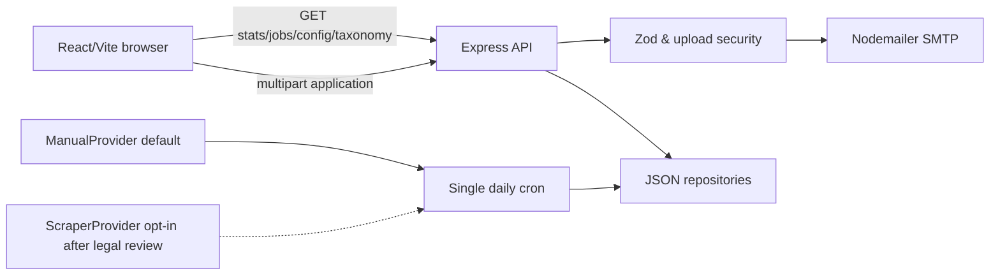

# Rozgar Links — Codex Implementation Specification

**Tagline:** Connecting People with Global Opportunities

**Urdu:** لوگوں کو مواقع سے جوڑنا
**Status:** Implementation in progress. Milestones 1–5 are complete.

## Overview and scope
Build a mobile-first, accessible Gulf hiring-assistance portal for applicants, primarily in Pakistan, seeking opportunities in Saudi Arabia, UAE, Oman, Qatar, Kuwait and Bahrain. Provide a daily **indicative** jobs dashboard, a searchable sample/authorized external listing directory, and a five-step application wizard that emails submitted details and attachments to an administrator. The service must not imply that a listed employer, GulfTalent or NaukriGulf has partnered with or endorsed Rozgar Links without written authorization. Never claim to guarantee employment.

### Features and routes
| Route | Required experience |
|---|---|
| `/` | Logo/nav; English + Urdu tagline; Apply CTA; four summary cards; country, industry and seven-day charts; featured jobs; three-step explanation; trust, FAQ, disclaimer/footer. |
| `/jobs` | Search; country/field filters; page/limit pagination; accessible cards with title, company, location, field, source and sample/verified badge; Apply with us and original-source link when genuine. |
| `/apply` | Five-step validated wizard: personal; preferences; documents; payment; review/submit. Persist in-memory wizard state across steps and guard navigation; optional sessionStorage draft excluding files and sensitive identifiers. |
| `/success` | Reference ID and next steps. Render email-sent claim only if the API confirms confirmation-email delivery. Do not allow an unverified reference to be generated client-side. |
| `/faq`, `/contact` | FAQ, legitimate business contact information/placeholders and service-process clarifications. |
| `/privacy`, `/terms`, `/fees-and-refunds` | Reviewable legal stubs with owner approval required before launch; retention, consent, fee/refund terms and no-guarantee language. |

## Technology and decisions
Use **TypeScript** across client, server and shared contracts for type-safe validation. React 18, Vite, React Router, Tailwind CSS, Recharts, React Hook Form, Zod, Axios, Lucide; Node 20, Express, Multer, Nodemailer, Zod, Helmet, CORS, express-rate-limit, dotenv, node-cron; Cheerio **only if legally cleared**. npm workspaces, ESLint, Prettier, Vitest, React Testing Library and Supertest. No database in v1; JSON repository abstraction behind `/server/src/repositories`. Build a single server process for JSON writes and cron. On multi-instance/serverless deployments, replace file storage and cron with durable shared storage and a single scheduler before production.

## Architecture


## Target layout (Codex generates app files)
```text
README.md  AGENTS.md  .env.example  .codex/config.toml
.agents/skills/<12 named skills>/SKILL.md
package.json  package-lock.json  eslint.config.*  .prettierrc*
client/  (src/app, src/pages, src/components, src/features, src/styles, public/logo.png)
server/  (src/app.ts, src/index.ts, src/routes, src/services, src/providers,
          src/repositories, src/jobs, src/email, src/middleware, data/)
shared/  (jobTaxonomy.json, src/schemas, src/types)
client/Dockerfile  server/Dockerfile  docker-compose.yml
```
User supplies `client/public/logo.png`; use a textual brand fallback until provided. Commit only sample/seed JSON; ignore runtime cache, uploaded/temp files and `.env`.

## Design tokens and UX
| Token | Value | Use |
|---|---|---|
| `--color-primary` | `#0B3C73` | Headings, buttons, ROZGAR |
| `--color-brand-blue` | `#1565A8` | CTAs, links |
| `--color-accent-blue` | `#4FA3C7` | Highlights |
| `--color-brand-green` | `#2E8B57` | LINKS, secondary action |
| `--color-light-green` | `#5DBB63` | Accents |
| `--color-bg` | `#FFFFFF` | Page |
| `--color-surface` | `#F5F8FB` | Cards |
| `--color-border` | `#E2E8F0` | Separators |
| `--color-text` | `#0F172A` | Main copy |
| `--color-muted` | `#475569` | Supporting copy |
| `--color-error` | `#DC2626` | Errors |
| `--color-warning` | `#D97706` | Warnings |
Use matching Tailwind theme variables, a subtle navy→blue→green hero gradient, Inter or Poppins for Latin, Noto Nastaliq Urdu for Urdu; accessible fallback fonts. Cards rounded-xl, subtle shadow, ample spacing. Mobile-first, accessible focus rings, form labels, full keyboard support, WCAG AA contrast; do not use color as sole status indicator. Lazy-load charts; honor reduced-motion preference. Lighthouse goal >=90 in each category on representative pages.

## Form contract
**All required indicators `*` reflect server validation.** Step 5 is review; actual submit is enabled only when **all** preceding steps pass, files are present, consents are true and request is not in flight. Step 4 Continue is likewise gated. Field-specific inline errors plus a missing-items summary; focus first error.

| Step | Fields and validation |
|---|---|
| 1 — Personal | `firstName*`, `lastName*` nonblank; `dateOfBirth*` age >=18 on submission date; `gender` optional; `nationality*`; `nationalId*` (Pakistani CNIC `#####-#######-#` when Pakistan; other national ID required but format depends on country, not assumed); `passportNumber*`; `passportExpiry*` >= six calendar months from submission; `email*` valid; `phone*` E.164 with country picker and WhatsApp label; `currentCity*`, `currentCountry*`; `maritalStatus` optional. |
| 2 — Preferences | `countries*` array, six GCC options or All Gulf which expands/deduplicates into all six; `field*` from taxonomy; `roles*` nonempty multi-select dependent on field; `otherRole` required when Other selected; `yearsExperience*` nonnegative; `highestEducation*`; `lastJobTitle`; `expectedSalaryMin`, `expectedSalaryMax`, `salaryCurrency` with ordered range; `preferredJoiningDate`; language levels; `hasDrivingLicence` and conditional `licenceCountry`; `willingToRelocate`; `skills[]`; `notes`. |
| 3 — Documents | `cv*` PDF/DOC/DOCX <=5 MiB; `passportCopy` and `photo` optional JPG/PNG/PDF <=5 MiB each; never persist raw documents in browser storage. |
| 4 — Payment | `paymentScreenshot*` JPEG/PNG <=5 MiB; preview + revoke object URL; `transactionReference*`, `paymentDate*` not future; `acceptTerms*`, `confirmAccuracy*`, `acceptFeePolicy*`; copy buttons for fake/demo bank fields. |
| 5 — Review | Read-only sanitized summary and edit-step links. Submit once, spinner, failure recovery without losing selected files. |

Shared Zod schema owns domain rules, transformations and cross-field refinements; backend independently checks all required fields, MIME, signatures, limits and consent. Multipart has `fields` JSON string and named `cv`, `paymentScreenshot`, optional `passportCopy` and `photo`. Unrecognized file fields rejected. Never trust `Content-Type`, filenames, browser-side validity or URL query params. `GET /api/config/public` exposes only non-secret payment display values and taxonomy version.

### Taxonomy requirements
Create `shared/jobTaxonomy.json` as `{ "version": "1.0.0", "fields": [{ "id": "construction", "label": "Construction", "roles": [{ "id": "mason", "label": "Mason" }] }] }`. Minimum **12** fields with **8–15** genuine distinct roles each: Construction, Hospitality, Healthcare, IT, Oil & Gas, Logistics, Retail, Drivers & Transport, Security, Engineering, Administration, Education. `Other` option per field or explicitly global; require text when selected. Stable lowercase kebab-case IDs, readable labels, unique IDs, validate taxonomy shape in CI. Clients consume `GET /api/taxonomy`; server verifies field-to-role membership from the same JSON. Never claim a role is currently open solely because it exists in taxonomy.

## Home stats and cron
`GET /api/stats`: `{date, totalOpenings, byCountry:[{country,count}], byField:[{field,count}], newToday, last7Days:[{date,totalOpenings}], lastUpdated, provenance:"estimated"|"authorized"}`. `GET /api/stats/history?days=7` accepts bounded integer days (1–30), returns chronological entries. Daily cron `5 0 * * *`, `Asia/Karachi`; env overrides (`STATS_CRON`, `TZ`). On startup regenerate if today's date in configured timezone is absent. Use seeded PRNG with ISO local-date key for deterministic fallback, ±5–12% day-to-day variation, sensible per-country and field weights. **Maintain one consistent total:** byCountry and byField each sum to totalOpenings; newToday nonnegative <= total; trend day values keyed deterministically. Atomic write temp+rename to `server/data/stats.json`; handle malformed data, concurrent triggers and timezone/day boundaries. When numbers are generated, label **“Indicative figures, updated daily”**, never “live verified openings”. Authorized source counts must record provenance and freshness. Cron errors preserve last valid snapshot and mark stale.

## Jobs aggregator and provenance
Use `JobProvider` interface, `ManualProvider` by default reading `server/data/jobs.seed.json` (~40 **fictional sample** records across GCC) and `ScraperProvider` as a disabled stub. Cache daily at `server/data/jobs.cache.json` via single scheduled refresh; read stale cache on provider failure with freshness notice. `GET /api/jobs?country=&field=&q=&page=&limit=` returns `{items,page,limit,total,totalPages,lastUpdated,provenance}`; defaults page 1, limit 12, cap limit 50; case-insensitive search; deterministic ordering, safe URL filtering. Each listing: id, title, company, country, city, field, source, sourceUrl|null, isSample, fetchedAt. **Never falsely attribute invented/sample jobs to GulfTalent or NaukriGulf.** Fictional records must show `Sample listing` and no fabricated original link; real imported jobs carry their true source label and original URL. UI language describing jobs as from external boards appears **only if authorized, genuine records exist**. Real original links open in new tab with `rel="noopener noreferrer"`.

Before enabling scraping, document per-domain robots.txt, exact applicable Terms and permission, scope, review date and applicable legal counsel/owner approval. Respect explicit prohibitions; do not evade anti-bot controls. Rate cap <=1 request every few seconds per domain, cache >=24h, identify User-Agent, metadata only, no full descriptions. If authorization or technical reliability is uncertain, keep `ENABLE_SCRAPING=false`. Prefer a documented feed, affiliate agreement or licensed API. Disclaimer on jobs/footer: “Rozgar Links is an independent service and is not affiliated with or endorsed by GulfTalent or NaukriGulf. Listings are shown for convenience; trademarks belong to their owners.”

## API reference
| Verb/path | Response and requirements |
|---|---|
| `GET /api/health` | 200 `{status:"ok"}`; no secrets. |
| `GET /api/config/public` | 200 bank display fields, fee and currency, `taxonomyVersion`, `isDemoPayment:true` until legal/real details approved; never expose SMTP credentials. |
| `GET /api/taxonomy` | 200 validated taxonomy JSON. |
| `GET /api/stats` | 200 daily snapshot with provenance; appropriate 503 on no usable data. |
| `GET /api/stats/history?days=7` | 200 dated trend; 400 invalid days. |
| `GET /api/jobs?...` | 200 paginated job envelope; 400 invalid filters. |
| `POST /api/applications` | multipart: `fields` JSON + named attachments; 201 `{success:true,referenceId,confirmationEmailSent:boolean}` on accepted admin delivery; 400 validation/upload errors; 429 abuse; 502/503 SMTP failure. Do not claim success when admin mail failed. |

Standard failure format `{success:false,error:{code,message,fieldErrors?}}`; avoid internal stack in production. Generate server-side reference `RL-YYYY-XXXXXX` using secure random characters; avoid duplicates within processing window. API `POST` is single-flight in client; support optional idempotency key with server-side bounded replay store if implementing retry safety, and document that no-database v1 cannot guarantee cross-restart deduplication. Email admin once per accepted request, with HTML-escaped full summary and memory attachments; optional applicant confirmation based on `SEND_APPLICANT_CONFIRMATION`. Record success/failure without PII. Never publicly serve uploaded documents. If SMTP down, fail safely and allow retry; no falsely successful reference.

## Environment variables
Refer to `.env.example` as authoritative template. Root startup loads `server/.env` or root `.env` consistently (document selection), no conflicting precedence; Vite needs only `VITE_API_BASE_URL` (and no secret values). `BANK_*` are **FAKE until replaced**. Do not put private bank or SMTP credentials in git. Defaults: port 4000, dev client 5173, rate limit five applications/IP/hour, `MAX_FILE_MB=5`, scraping off, timezone Asia/Karachi.

The M1 server loads a root `.env` when present, otherwise `server/.env`, then applies safe scaffold defaults for `PORT`, `CLIENT_URL` and `NODE_ENV`. Run `npm ci` followed by `npm run dev`; the client uses the Vite `/api` proxy during local development.

## Security and data handling checklist
- [ ] Helmet; exact-origin CORS using `CLIENT_URL`; rate limit applications 5/IP/hour; reverse proxy trust configured only for known proxies.
- [ ] Zod on all data and query params, length bounds, safe HTML escaping in email, reject extra multipart files and dangerous content.
- [ ] Multer memory or private temp dir, strict byte limits, MIME **and** magic-byte inspection for PDF/JPEG/PNG/DOC/DOCX; ZIP-based OOXML DOCX validation; fail closed if unverifiable; delete temp files in `finally` on all paths. Limit file count and total request size.
- [ ] Files sent only to configured admin via TLS SMTP; no disk persistence of applicant PII by default; disable logs of names, email, national IDs, passports, transaction details and document bytes.
- [ ] Honeypot and optional CAPTCHA hook; avoid leaking CAPTCHA secret. Sanitize error messages; never log env secrets.
- [ ] No client-side claim of payment verification; screenshot is **unverified proof**, never a verified transaction. Manual offline review needed.
- [ ] Privacy/Terms/fees pages accessible before consent; owner-approved deletion/retention procedure and contact channel; document third-party SMTP data transfer.
- [ ] Add Content Security Policy compatible with frontend and avoid rendering unsafe HTML.

## Legal and Risk — mandatory pre-launch gates
**Not legal advice.** In Pakistan, overseas employment recruitment/placement and fee collection can require licensing/approval (e.g. Bureau of Emigration & Overseas Employment / applicable regulator). **Owner must obtain qualified legal review, confirm legal authority and licensing, lawful fee/refund terms and authorization to process documents and payment proofs BEFORE enabling a paid/public service.** Publish verified licence number (`RECRUITMENT_LICENSE_NUMBER` placeholder), legal entity and service-contact details; no job-guarantee wording. A fee collection screen with demo bank details is a **non-operational demonstration** until legal, payments and identity checks pass. Provide clear fee/refund policy and explicit consent; disclose that placement is not guaranteed. Privacy/terms stubs require legal sign-off; establish a defined retention/deletion timeline and subject-access channel. Preserve receipts and policies as required by applicable law, but don't introduce a data-retaining database without design approval.

## Testing and quality
Use `npm ci`, `npm run lint`, `npm test`, `npm run build` from root; tests must cover deterministic stats, timezone rollover, aggregation totals, stale fallback, sample provenance, pagination/filtering, Zod cross-field rules (18+, passport 6 months, CNIC), upload spoofing/signatures/count/size/cleanup, rate limit, XSS-safe email formatting, one admin email and SMTP failure, single submit and all consent gates, WCAG checks, responsive page navigation. Mock SMTP and external providers: no network in unit tests. Target Lighthouse >=90 across performance/accessibility/best practices/SEO on configured benchmark. Verify keyboard, screen readers and mobile layouts manually.

## Deployment
Local `npm install` (commit lockfile), copy `.env.example` to `.env`, fill safe local settings, run `npm run dev`. Production root build and Express start with separately built client. Implement `/client/Dockerfile`, `/server/Dockerfile`, `docker-compose.yml`; server's writable `server/data` is a persistent volume, uploaded temps ephemeral, secrets runtime environment. Bind only API as required; HTTPS/TLS, SMTP, strict CORS, health checks, log/backup strategy. Vercel/Netlify client and Render/Railway/VPS server are options **only with persistent storage + a single cron worker**; nonpersistent/serverless filesystem invalidates JSON cache design. Deployment docs must show env injection, migrations not applicable, rollback and monitoring.

## Build order (commit after every milestone)
- [x] **M1 — Scaffold:** workspaces, TypeScript, shared package, root scripts, lint/test/build, `.gitignore`, logo fallback, app/router/server health. **Accept:** clean install, health endpoint, lint/build/test pass. Commit `chore: scaffold monorepo`.
- [x] **M2 — Brand/pages:** Tailwind tokens, responsive layout, nav/footer, home shell, jobs/apply placeholders, FAQ/contact/privacy/terms/fees stub routes. **Accept:** WCAG keyboard basics and matching palette. Commit `feat: add brand shell and pages`.
- [x] **M3 — Shared taxonomy/schema:** 12x8–15 role data, shared Zod application validation, taxonomy route/public config. **Accept:** conditional schema and unique-ID tests. Commit `feat: add taxonomy and contracts`.
- [x] **M4 — Stats:** deterministic generator, repository, daily scheduler and stats/history endpoints, frontend charts/labels/states. **Accept:** same date same totals, coherent sums, timezone rollover tests. Commit `feat: add daily indicative dashboard`.
- [x] **M5 — Jobs:** ManualProvider with ~40 fictional samples, interface, cache/refresh, jobs endpoint/filters/cards, non-endorsement, scraper stub. **Accept:** accurate sample labels, no invented external URLs, query tests. Commit `feat: add sample job directory`.
- [x] **M6 — Application wizard:** all personal, preference and file/payment steps, review, progress, validation/UI tests. **Accept:** disabled submission until all required fields/files/consents valid, accessible errors. Commit `feat: build application wizard`.
- [x] **M7 — Secure submission/email:** multipart endpoint, content signatures, sanitization, admin email, confirmation toggle, error handling/rate limits. **Accept:** mocked upload/email/security test matrix; SMTP fail never reports success. Commit `feat: secure applications and email delivery`.
- [x] **M8 — E2E polish and deploy:** success flow, anti-bot, responsive polish, test suite, Lighthouse, Docker/compose, env/deployment notes/legal checklist. **Accept:** root scripts green; demo states clearly labeled; owner launch gates documented. Commit `chore: verify and package deployment`.

## Definition of Done
All routes and endpoints work; documents and screenshots are validated in client and server; admin receives the submitted summary/attachments when a 201 is issued; generated data is explicitly indicative; samples never masquerade as real openings; legal placeholders and fee disclaimers visible; unit/component/API tests green; accessible, responsive UI; no PII in logs or committed data; reproducible startup/build; every milestone has its own passing commit. **Production go-live is blocked until licensing, fees/refunds, privacy, source permissions and real payment details have been independently approved.**

## Assumptions
No authentication/admin panel in v1; administrator edits seed JSON through repository/deployment workflow. `All Gulf countries` expands to six GCC choices. Currency dropdown supports PKR, SAR, AED, OMR, QAR, KWD, BHD, USD. Default language levels: basic/intermediate/advanced/fluent. Application data is emailed and not stored permanently; optional temporary processing only. Date-based estimates are simulated, not genuine counts. Payment proof is not payment verification. The jobs seed is fictional; there are **no claimed GulfTalent/NaukriGulf jobs** until legitimate source authorization is confirmed. Contact/legal copy must be reviewed by business owner.

## How to use this kit with Codex
Place the contents of this kit at your **empty repository root**. Supply your logo as `client/public/logo.png` when the scaffold creates the folder. Review `.env.example` and **do not use fake payment values with actual applicants**. Start Codex in the root and prompt:

> Read `README.md`, `AGENTS.md` and the relevant `.agents/skills/*/SKILL.md` files. Execute **Milestone 1 only**. Run lint, tests and build, report results, then commit with the prescribed message. Do not start Milestone 2 until I approve.
