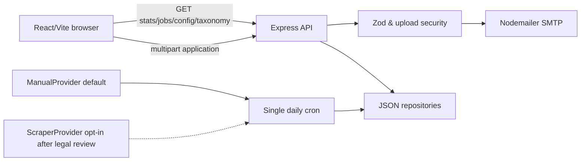

# Rozgar Links — Codex Implementation Specification

**Tagline:** Connecting People with Global Opportunities

**Urdu:** لوگوں کو مواقع سے جوڑنا
**Status:** Implementation in progress. Milestones 1–5 are complete.

## Overview and scope
Build a mobile-first, accessible Gulf hiring-assistance portal for applicants, primarily in Pakistan, seeking opportunities in Saudi Arabia, UAE, Oman, Qatar, Kuwait and Bahrain. Provide a daily **indicative** jobs dashboard, a searchable sample/authorized external listing directory, and a five-step application wizard that emails submitted details and attachments to an administrator. The service must not imply that a listed employer, GulfTalent or NaukriGulf has partnered with or endorsed Rozgar Links without written authorization. Never claim to guarantee employment.

### Features and routes
| Route | Required experience |
|---|---|
| `/` | Logo/nav; English + Urdu tagline; Apply CTA; four summary cards; country, industry and seven-day charts; featured jobs; three-step explanation; trust, FAQ, disclaimer/footer. |
| `/jobs` | Bilingual 64-occupation GCC directory; URL-backed search, category, designation and salary filters; stable sorting and pagination; country filtering uses explicitly labelled random sample associations across all six GCC countries. |
| `/apply` | Five-step validated wizard: personal; preferences; documents; payment; review/submit. Persist in-memory wizard state across steps and guard navigation; optional sessionStorage draft excluding files and sensitive identifiers. |
| `/success` | Reference ID and next steps. Render email-sent claim only if the API confirms confirmation-email delivery. Do not allow an unverified reference to be generated client-side. |
| `/admin/login`, `/admin/cv` | Private single-admin login and authenticated PDF issuance/download, without a database; setup and security limits in [admin panel guide](docs/admin-panel.md). |
| `/faq`, `/contact` | FAQ, legitimate business contact information/placeholders and service-process clarifications. |
| `/privacy`, `/terms`, `/fees-and-refunds` | Reviewable legal stubs with owner approval required before launch; retention, consent, fee/refund terms and no-guarantee language. |

## Technology and decisions
Use **TypeScript** across client, server and shared contracts for type-safe validation. React 18, Vite, React Router, Tailwind CSS, Recharts, React Hook Form, Zod, Axios, Lucide; Node 20, Express, Multer, Nodemailer, Zod, Helmet, CORS, express-rate-limit, dotenv, node-cron; Cheerio **only if legally cleared**. npm workspaces, ESLint, Prettier, Vitest, React Testing Library and Supertest. No database in v1; JSON repository abstraction behind `/server/src/repositories`. Build a single server process for JSON writes and cron. On multi-instance/serverless deployments, replace file storage and cron with durable shared storage and a single scheduler before production.

## Architecture


## Target layout (Codex generates app files)
```text
README.md  AGENTS.md  .env.example  .codex/config.toml
.agents/skills/<12 named skills>/SKILL.md
package.json  package-lock.json  eslint.config.*  .prettierrc*
client/  (src/app, src/pages, src/components, src/features, src/styles, public/logo.png)
server/  (src/app.ts, src/index.ts, src/routes, src/services, src/providers,
          src/repositories, src/jobs, src/email, src/middleware, data/)
shared/  (jobTaxonomy.json, src/schemas, src/types)
client/Dockerfile  server/Dockerfile  docker-compose.yml
```
User supplies `client/public/logo.png`; use a textual brand fallback until provided. Commit only sample/seed JSON; ignore runtime cache, uploaded/temp files and `.env`.

## Design tokens and UX
| Token | Value | Use |
|---|---|---|
| `--color-primary` | `#0B3C73` | Headings, buttons, ROZGAR |
| `--color-brand-blue` | `#1565A8` | CTAs, links |
| `--color-accent-blue` | `#4FA3C7` | Highlights |
| `--color-brand-green` | `#2E8B57` | LINKS, secondary action |
| `--color-light-green` | `#5DBB63` | Accents |
| `--color-bg` | `#FFFFFF` | Page |
| `--color-surface` | `#F5F8FB` | Cards |
| `--color-border` | `#E2E8F0` | Separators |
| `--color-text` | `#0F172A` | Main copy |
| `--color-muted` | `#475569` | Supporting copy |
| `--color-error` | `#DC2626` | Errors |
| `--color-warning` | `#D97706` | Warnings |
Use matching Tailwind theme variables, a subtle navy→blue→green hero gradient, Inter or Poppins for Latin, Noto Nastaliq Urdu for Urdu; accessible fallback fonts. Cards rounded-xl, subtle shadow, ample spacing. Mobile-first, accessible focus rings, form labels, full keyboard support, WCAG AA contrast; do not use color as sole status indicator. Lazy-load charts; honor reduced-motion preference. Lighthouse goal >=90 in each category on representative pages.

## Form contract

The current two-journey application flow is specified in [docs/cv-workflow.md](docs/cv-workflow.md). This supersedes older milestone form requirements.

| Step | Current inputs and behavior |
| --- | --- |
| 1 - Personal | First name, last name, optional gender, email, Pakistani WhatsApp number (03 + 9 digits), and job field. |
| 2 - Preferences | GCC countries / All Gulf and one to three unique active occupations, filtered through an explicit field-to-occupation mapping. |
| 3 - CV Status | Existing official CV: PDF upload and server verification. New CV: preparation request, no existing CV needed. |
| 4 - Payment | New-CV requests only: configured one-time preparation fee (default PKR 250), demo bank details/copy controls and JPEG/PNG screenshot <=5 MiB. Returning verified applicants skip this step. |
| 5 - Review | Common details, selected occupations and journey-specific status/attachment. Returning applicants show official CV reference and PKR 0. New requests await manual payment review. |

CNIC, DOB, current city, passport, years of experience and transaction-reference fields are not collected. No automatic payment verification or CV generation occurs on submission. Client and server share a strict Zod contract. Changing journeys resets incompatible uploads and verification state. Submissions remain disabled by default and payment details remain demo-only.

Multipart uses `fields` JSON plus an empty `website` honeypot and exactly one attachment: `cv` for `existing_rozgar_cv`, or `paymentScreenshot` for `new_cv_required`. Final submission independently re-verifies official CVs and rejects the wrong attachment. Only one accepted administrator email produces HTTP 201. No applicant copies, database, public uploads or PII persistence are introduced.

Official PDFs can be issued through the authenticated `/admin/cv` web panel or the private admin CLI using approved `pdf-lib`, then bound to their exact bytes with SHA-256 and a dedicated HMAC-SHA256 key. Both use the same issuance service. See [admin setup and operation](docs/admin-panel.md) and the workflow document for configuration, legacy reissuance, integrity guarantees and limitations.

### Taxonomy requirements
Create `shared/jobTaxonomy.json` as `{ "version": "1.0.0", "fields": [{ "id": "construction", "label": "Construction", "roles": [{ "id": "mason", "label": "Mason" }] }] }`. Minimum **12** fields with **8–15** genuine distinct roles each: Construction, Hospitality, Healthcare, IT, Oil & Gas, Logistics, Retail, Drivers & Transport, Security, Engineering, Administration, Education. `Other` option per field or explicitly global; require text when selected. Stable lowercase kebab-case IDs, readable labels, unique IDs, validate taxonomy shape in CI. Clients consume `GET /api/taxonomy`; server verifies field-to-role membership from the same JSON. Never claim a role is currently open solely because it exists in taxonomy.

## Home stats and cron
`GET /api/stats`: `{date, totalOpenings, byCountry:[{country,count}], byField:[{field,count}], newToday, last7Days:[{date,totalOpenings}], lastUpdated, provenance:"estimated"|"authorized"}`. `GET /api/stats/history?days=7` accepts bounded integer days (1–30), returns chronological entries. Daily cron `5 0 * * *`, `Asia/Karachi`; env overrides (`STATS_CRON`, `APP_TIME_ZONE`). On startup regenerate if today's date in configured timezone is absent. Use seeded PRNG with ISO local-date key for deterministic fallback, ±5–12% day-to-day variation, sensible per-country and field weights. **Maintain one consistent total:** byCountry and byField each sum to totalOpenings; newToday nonnegative <= total; trend day values keyed deterministically. Atomic write temp+rename to `server/data/stats.json`; handle malformed data, concurrent triggers and timezone/day boundaries. When numbers are generated, label **“Indicative figures, updated daily”**, never “live verified openings”. Authorized source counts must record provenance and freshness. Cron errors preserve last valid snapshot and mark stale.

## Occupation directory and provenance
Use `JobProvider` with `ManualProvider` reading `shared/occupations.seed.json`: exactly 64 bilingual occupations in nine categories from the Rozgar Link Master GCC Occupations & Salary Directory (2026). Cache the validated normalized catalog at `server/data/jobs.cache.json` with stale-cache fallback. `GET /api/jobs` supports bilingual title search, category, designation, predefined salary membership, custom salary overlap, stable sorting and pagination. Public responses never expose internal salary-group identifiers. Directory cards show exact indicative monthly SAR ranges and never present an occupation as a vacancy or guaranteed offer. Each occupation has stable random sample associations with one to three of the six GCC countries; country filtering is enabled and associations are labelled as samples.

Before enabling scraping, document per-domain robots.txt, exact applicable Terms and permission, scope, review date and applicable legal counsel/owner approval. Respect explicit prohibitions; do not evade anti-bot controls. Rate cap <=1 request every few seconds per domain, cache >=24h, identify User-Agent, metadata only, no full descriptions. If authorization or technical reliability is uncertain, keep `ENABLE_SCRAPING=false`. Prefer a documented feed, affiliate agreement or licensed API. Disclaimer on jobs/footer: “Rozgar Links is an independent service and is not affiliated with or endorsed by GulfTalent or NaukriGulf. Listings are shown for convenience; trademarks belong to their owners.”

## API reference
Job cards link to `/apply?job=<occupation-id>`. The application checks the ID against the shared active occupation catalog, selects a compatible job field and preselects that occupation in Preferences. Applicants can edit these choices using the existing one-to-three occupation rules. Ordinary `/apply` entry keeps the existing blank selections; sample country assignments are not automatically selected as applicant preferences.

| Verb/path | Response and requirements |
|---|---|
| `GET /api/health` | 200 `{status:"ok"}`; no secrets. |
| `GET /api/config/public` | 200 bank display fields, fee and currency, `taxonomyVersion`, `isDemoPayment:true` until legal/real details approved; never expose SMTP credentials. |
| `GET /api/taxonomy` | 200 validated taxonomy JSON. |
| `GET /api/stats` | 200 daily snapshot with provenance; appropriate 503 on no usable data. |
| `GET /api/stats/history?days=7` | 200 dated trend; 400 invalid days. |
| `GET /api/jobs?...` | 200 paginated job envelope; 400 invalid filters. |
| `POST /api/cv/verify` | multipart PDF `cv`; validates signed identity and exact-byte integrity; no persistence. |
| `/api/admin/login`, `/api/admin/session`, `/api/admin/logout`, `/api/admin/cv/issue` | Private cookie-authenticated admin APIs with CSRF/Origin checks; see [admin panel guide](docs/admin-panel.md). |
| `POST /api/applications` | multipart: `fields` JSON + exactly one journey-specific attachment; 201 `{success:true,referenceId}` on accepted admin delivery; 400 validation/upload errors; 429 abuse; 502/503 SMTP failure. Do not claim success when admin mail failed. |

Standard failure format `{success:false,error:{code,message,fieldErrors?}}`; avoid internal stack in production. Generate server-side reference `RL-YYYY-XXXXXX` using secure random characters; avoid duplicates within processing window. API `POST` is single-flight in client; support optional idempotency key with server-side bounded replay store if implementing retry safety, and document that no-database v1 cannot guarantee cross-restart deduplication. Email exactly one configured administrator once per accepted request, with an HTML-escaped summary and memory attachments. Do not send applicant, CC or BCC copies. Record success/failure without PII. Never publicly serve uploaded documents. If SMTP is down, fail safely and allow retry; no falsely successful reference.

## Environment variables
Refer to `.env.example` as authoritative template. Root startup loads `server/.env` or root `.env` consistently (document selection), no conflicting precedence; Vite needs only `VITE_API_BASE_URL` (and no secret values). `BANK_*` are **FAKE until replaced**. Do not put private bank or SMTP credentials in git. Defaults: submissions off, port 4000, dev client 5173, rate limit five applications/IP/hour, `MAX_FILE_MB=5`, scraping off, timezone Asia/Karachi.

The M1 server loads a root `.env` when present, otherwise `server/.env`, then applies safe scaffold defaults for `PORT`, `CLIENT_URL` and `NODE_ENV`. Run `npm ci` followed by `npm run dev`; the client uses the Vite `/api` proxy during local development.

## Security and data handling checklist
- [ ] Helmet; exact-origin CORS using `CLIENT_URL`; rate limit applications 5/IP/hour; reverse proxy trust configured only for known proxies.
- [ ] Zod on all data and query params, length bounds, safe HTML escaping in email, reject extra multipart files and dangerous content.
- [ ] Multer memory or private temp dir, strict byte limits, MIME **and** magic-byte inspection for PDF/JPEG/PNG/DOC/DOCX; ZIP-based OOXML DOCX validation; fail closed if unverifiable; delete temp files in `finally` on all paths. Limit file count and total request size.
- [ ] Files sent only to configured admin via TLS SMTP; no disk persistence of applicant PII by default; disable logs of names, email, national IDs, passports, transaction details and document bytes.
- [ ] Honeypot and optional CAPTCHA hook; avoid leaking CAPTCHA secret. Sanitize error messages; never log env secrets.
- [ ] No client-side claim of payment verification; screenshot is **unverified proof**, never a verified transaction. Manual offline review needed.
- [ ] Privacy/Terms/fees pages accessible before consent; owner-approved deletion/retention procedure and contact channel; document third-party SMTP data transfer.
- [ ] Add Content Security Policy compatible with frontend and avoid rendering unsafe HTML.

## Legal and Risk — mandatory pre-launch gates
**Not legal advice.** In Pakistan, overseas employment recruitment/placement and fee collection can require licensing/approval (e.g. Bureau of Emigration & Overseas Employment / applicable regulator). **Owner must obtain qualified legal review, confirm legal authority and licensing, lawful fee/refund terms and authorization to process documents and payment proofs BEFORE enabling a paid/public service.** Publish verified licence number (`RECRUITMENT_LICENSE_NUMBER` placeholder), legal entity and service-contact details; no job-guarantee wording. A fee collection screen with demo bank details is a **non-operational demonstration** until legal, payments and identity checks pass. Provide clear fee/refund policy and explicit consent; disclose that placement is not guaranteed. Privacy/terms stubs require legal sign-off; establish a defined retention/deletion timeline and subject-access channel. Preserve receipts and policies as required by applicable law, but don't introduce a data-retaining database without design approval.

## Testing and quality
Use `npm ci`, `npm run lint`, `npm test`, `npm run build` from root; tests must cover deterministic stats, timezone rollover, aggregation totals, stale fallback, sample provenance, pagination/filtering, current shared Zod journey rules, one-to-three occupation selection and field compatibility, upload spoofing/signatures/count/size/cleanup, rate limit, XSS-safe email formatting, one admin email and SMTP failure, single submit, WCAG checks, responsive page navigation. Mock SMTP and external providers: no network in unit tests. Target Lighthouse >=90 across performance/accessibility/best practices/SEO on configured benchmark. Verify keyboard, screen readers and mobile layouts manually.

## Deployment
Local `npm install` (commit lockfile), copy `.env.example` to `.env`, fill safe local settings, run `npm run dev`. Production root build and Express start with separately built client. Implement `/client/Dockerfile`, `/server/Dockerfile`, `docker-compose.yml`; server's writable `server/data` is a persistent volume, uploaded temps ephemeral, secrets runtime environment. Bind only API as required; HTTPS/TLS, SMTP, strict CORS, health checks, log/backup strategy. Vercel/Netlify client and Render/Railway/VPS server are options **only with persistent storage + a single cron worker**; nonpersistent/serverless filesystem invalidates JSON cache design. Deployment docs must show env injection, migrations not applicable, rollback and monitoring.

## Build order (commit after every milestone)
- [x] **M1 — Scaffold:** workspaces, TypeScript, shared package, root scripts, lint/test/build, `.gitignore`, logo fallback, app/router/server health. **Accept:** clean install, health endpoint, lint/build/test pass. Commit `chore: scaffold monorepo`.
- [x] **M2 — Brand/pages:** Tailwind tokens, responsive layout, nav/footer, home shell, jobs/apply placeholders, FAQ/contact/privacy/terms/fees stub routes. **Accept:** WCAG keyboard basics and matching palette. Commit `feat: add brand shell and pages`.
- [x] **M3 — Shared taxonomy/schema:** 12x8–15 role data, shared Zod application validation, taxonomy route/public config. **Accept:** conditional schema and unique-ID tests. Commit `feat: add taxonomy and contracts`.
- [x] **M4 — Stats:** deterministic generator, repository, daily scheduler and stats/history endpoints, frontend charts/labels/states. **Accept:** same date same totals, coherent sums, timezone rollover tests. Commit `feat: add daily indicative dashboard`.
- [x] **M5 — Jobs:** ManualProvider occupation directory, cache/refresh, bilingual search, combined filters, sorting, pagination and honest salary/country states. **Accept:** exactly 64 occupations and nine categories, no invented vacancies or country associations, query tests.
- [x] **M6 — Application wizard:** all personal, preference and file/payment steps, review, progress, validation/UI tests. **Accept:** disabled submission until all required fields/files/consents valid, accessible errors. Commit `feat: build application wizard`.
- [x] **M7 — Secure submission/email:** multipart endpoint, content signatures, sanitization, one-recipient admin email, error handling/rate limits. **Accept:** mocked upload/email/security test matrix; SMTP fail never reports success. Commit `feat: secure applications and email delivery`.
- [x] **M8 — E2E polish and deploy:** success flow, anti-bot, responsive polish, test suite, Lighthouse, Docker/compose, env/deployment notes/legal checklist. **Accept:** root scripts green; demo states clearly labeled; owner launch gates documented. Commit `chore: verify and package deployment`.

## Definition of Done
All routes and endpoints work; documents and screenshots are validated in client and server; admin receives the submitted summary/attachments when a 201 is issued; generated data is explicitly indicative; samples never masquerade as real openings; legal placeholders and fee disclaimers visible; unit/component/API tests green; accessible, responsive UI; no PII in logs or committed data; reproducible startup/build; every milestone has its own passing commit. **Production go-live is blocked until licensing, fees/refunds, privacy, source permissions and real payment details have been independently approved.**

## Assumptions
No applicant accounts; the single-admin CV issuance panel uses private environment credentials and stateless signed cookies without a database. Administrator edits seed JSON through repository/deployment workflow. `All Gulf countries` expands to six GCC choices. Currency dropdown supports PKR, SAR, AED, OMR, QAR, KWD, BHD, USD. Default language levels: basic/intermediate/advanced/fluent. Application data is emailed and not stored permanently; optional temporary processing only. Date-based estimates are simulated, not genuine counts. Payment proof is not payment verification. The jobs seed is fictional; there are **no claimed GulfTalent/NaukriGulf jobs** until legitimate source authorization is confirmed. Contact/legal copy must be reviewed by business owner.

## How to use this kit with Codex
Place the contents of this kit at your **empty repository root**. Supply your logo as `client/public/logo.png` when the scaffold creates the folder. Review `.env.example` and **do not use fake payment values with actual applicants**. Start Codex in the root and prompt:

> Read `README.md`, `AGENTS.md` and the relevant `.agents/skills/*/SKILL.md` files. Execute **Milestone 1 only**. Run lint, tests and build, report results, then commit with the prescribed message. Do not start Milestone 2 until I approve.
